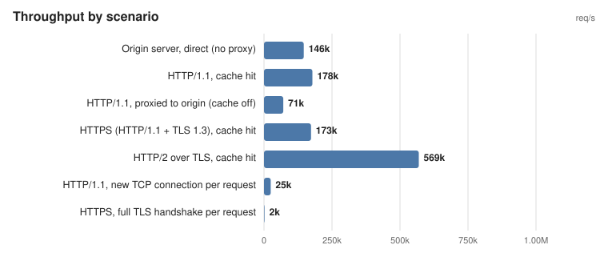
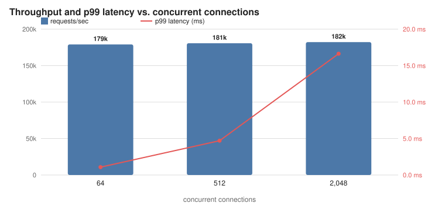
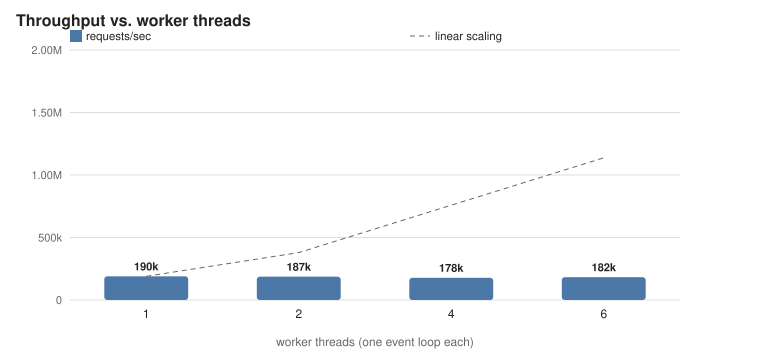

# aproxy benchmark results

Generated by `bench/run.sh` on 2026-11-21T04:24:13Z at commit `5cfd4a2-dirty`. Re-run with `./bench/run.sh`; raw tool output for every number is kept in `bench/results/<timestamp>/raw/`.

## Highlights

- **569,058 requests/sec** peak throughput (HTTP/2 over TLS, cache hit, 64 connections, 6 worker threads)
- **177,943 req/s** on cache hits over HTTP/1.1 with **p99 latency of 4.09 ms** at 256 concurrent connections
- **70,973 req/s** reverse-proxied to load-balanced upstreams (p99 16.74 ms); the cache serves **2.5×** more requests than the proxied path
- **172,899 req/s over TLS 1.3**, 97% of plaintext throughput (p99 3.41 ms)
- **569,058 req/s over HTTP/2** with 64 connections × 32 multiplexed streams
- **1,810 full TLS handshakes/sec**
- **1,024 concurrent keep-alive connections** handled with zero errors at 145,969 req/s (p99 24.82 ms), using 121 MB RSS
- **1.2× throughput scaling** from 1 to 6 worker threads (390,795 → 469,936 req/s over HTTP/2), one shared-nothing event loop per thread
- **47.1 Gbit/s** served from cache with 256 KiB responses

Resume-ready one-liner

> Built a multi-threaded, event-driven (kqueue/epoll) reverse proxy in C with HTTP/1.1, HTTP/2, HTTP/3 (QUIC), TLS 1.3 termination, load balancing and a sharded LRU cache; benchmarked at 569k req/s, p99 4.09 ms, 1,024 concurrent connections, 1.2× multi-core scaling on a 10-core Apple M5.

## Test environment

| | |
|---|---|
| CPU | Apple M5 |
| Logical cores | 10 |
| Memory (GB) | 24 |
| OS | Darwin 27.2.0 |
| Proxy build | aproxy 0.1.0 (http/2: yes, http/3: yes) |
| Compiler | Apple clang version 21.0.0 (clang-2100.4.1.1) |
| wrk | wrk 4.2.0 [kqueue] |
| h2load | h2load nghttp2/1.71.0 |
| Proxy worker threads | 6 |
| Load-generator threads | 4 |
| Measured duration per run (s) | 15 |
| Warm-up per run (s) | 3 |
| CPU pinning (taskset) | 0 |

Load generator, proxy and origin servers share the same machine over loopback, so absolute numbers are a lower bound on what the proxy alone can do. Compare runs only on the same hardware.

## Scenarios

| Scenario | Conns | Req/s | p50 | p90 | p99 | p99.9 | Max | Errors | MB/s | Peak RSS (MB) |
|---|---:|---:|---:|---:|---:|---:|---:|---:|---:|---:|
| Origin server, direct (no proxy) | 256 | **146,039** | 1.09 ms | 1.97 ms | 4.64 ms | 11.89 ms | 30.96 ms | 0 | 20.9 | — |
| HTTP/1.1, cache hit | 256 | **177,943** | 957 µs | 1.85 ms | 4.09 ms | 8.80 ms | 21.49 ms | 0 | 49.0 | 13.6 |
| HTTP/1.1, proxied to origin (cache off) | 256 | **70,973** | 3.23 ms | 6.23 ms | 16.74 ms | 59.10 ms | 117.56 ms | 0 | 17.9 | 16.9 |
| HTTPS (HTTP/1.1 + TLS 1.3), cache hit | 256 | **172,899** | 889 µs | 1.68 ms | 3.41 ms | 8.65 ms | 27.07 ms | 0 | 47.6 | 34.3 |
| HTTP/2 over TLS, cache hit | 64×32 | **569,058** | 2.91 ms | — | 7.51 ms | — | 22.60 ms | 0 | 37.6 | 36.7 |
| HTTP/1.1, new TCP connection per request | 256 | **24,735** | 4.45 ms | 5.16 ms | 65.37 ms | 138.10 ms | 148.78 ms | 294 | 6.7 | 36.3 |
| HTTPS, full TLS handshake per request | 256 | **1,810** | 42 µs | 60 µs | 252 µs | 379 µs | 21.03 ms | 255 | 0.5 | 35.4 |

HTTP/2 and HTTP/3 rows come from h2load, which reports median, p99, mean and max only. `Conns` shows connections × concurrent streams.

## Concurrency sweep (HTTP/1.1 cache hit)

| Connections | Conns | Req/s | p50 | p90 | p99 | p99.9 | Max | Errors | MB/s | Peak RSS (MB) |
|---|---:|---:|---:|---:|---:|---:|---:|---:|---:|---:|
| 16 | 16 | **160,518** | 86 µs | 119 µs | 174 µs | 5.91 ms | 17.40 ms | 0 | 44.5 | 156.5 |
| 64 | 64 | **134,199** | 365 µs | 787 µs | 4.20 ms | 22.26 ms | 57.16 ms | 0 | 37.2 | 156.5 |
| 256 | 256 | **152,042** | 1.36 ms | 3.10 ms | 7.12 ms | 28.31 ms | 53.40 ms | 0 | 42.1 | 116.5 |
| 1,024 | 1024 | **145,969** | 4.28 ms | 12.19 ms | 24.82 ms | 62.83 ms | 96.77 ms | 0 | 40.4 | 120.5 |
| 4,096 | 4096 | **136,130** | 22.00 ms | 53.16 ms | 110.04 ms | 193.11 ms | 226.06 ms | 25 | 37.7 | 94.4 |

## Multi-core scaling (HTTP/2 over TLS, cache hit)

Measured with h2load (64 connections × 32 streams). Over loopback, HTTP/1.1 with one request per round trip saturates the load generator before a single proxy worker is busy, so it cannot show scaling. On CPUs with performance and efficiency cores, the extra workers land on slower cores and gains flatten.

| Worker threads | Req/s | Speed-up | Efficiency | p99 / max |
|---:|---:|---:|---:|---:|
| 1 | **390,795** | 1.00× | 100% | 9.55 ms / 22.66 ms |
| 2 | **346,960** | 0.89× | 44% | 51.28 ms / 130.40 ms |
| 4 | **444,130** | 1.14× | 28% | 16.99 ms / 87.64 ms |
| 6 | **469,936** | 1.20× | 20% | 9.98 ms / 40.92 ms |

## Response size (HTTP/1.1 cache hit)

| Body size | Req/s | Throughput | p50 | p99 |
|---:|---:|---:|---:|---:|
| 1 KiB | **179,249** | 1.84 Gbit/s | 978 µs | 2.96 ms |
| 16 KiB | **130,241** | 17.34 Gbit/s | 2.79 ms | 5.87 ms |
| 256 KiB | **22,423** | 47.07 Gbit/s | 5.78 ms | 8.98 ms |

## Proxy counters at the end of the run

From `GET /__status`: 10,066,318 requests on the final proxy instance, 72 connections, cache hit ratio 99.99% (10,065,620 hits / 695 misses), 0 upstream errors.

## Skipped

- h3-hit: skipped, h2load without QUIC support or proxy without HTTP/3

## Methodology

- Each scenario gets a warm-up run that is thrown away, then one measured run of fixed duration.
- Requests/sec counts **successful (2xx/3xx) responses only**; any socket error, timeout or 4xx/5xx is listed under Errors.
- Latency percentiles are measured by wrk (HTTP/1.1) and h2load (HTTP/2, HTTP/3). wrk is a closed-loop generator, so the percentiles are subject to coordinated omission; treat p99.9 / max as indicative.
- Origins are `bench/origin.c` (two instances, round-robin), a minimal C server, so that the proxied path measures the proxy rather than the backend.
- The access log is disabled (`log_level warn`); the config is `bench/lib/proxy.conf.in`.
- `Peak RSS` is the proxy's resident memory sampled every 0.5 s during the run.
- The OS listen backlog limit (somaxconn) was 128, so connect errors at high connection counts or in connection-per-request runs can come from the kernel dropping SYNs during bursts rather than from the proxy.
